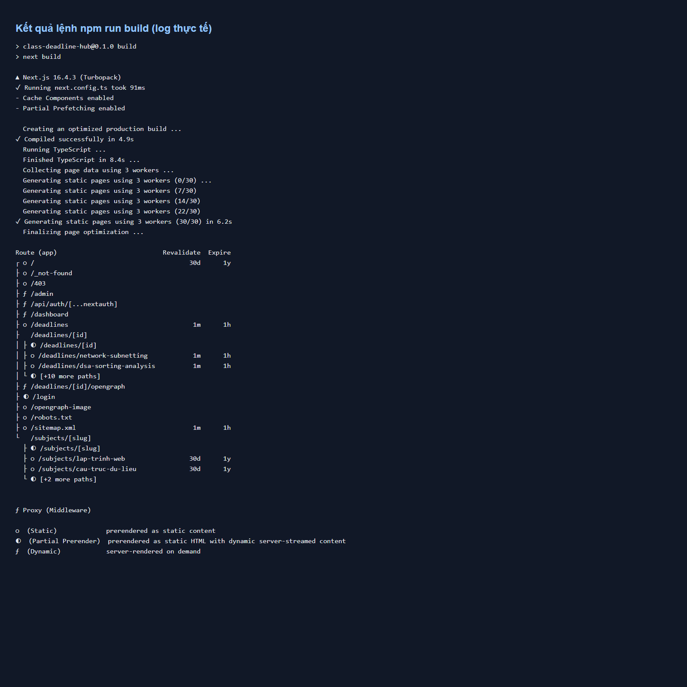
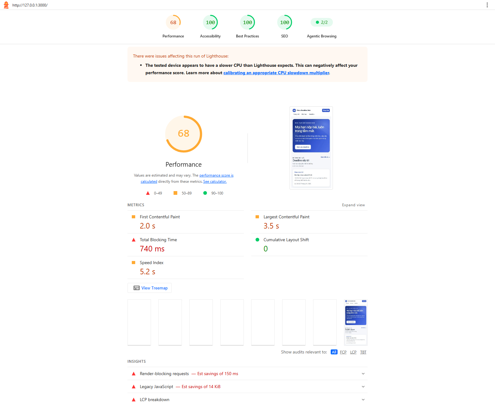
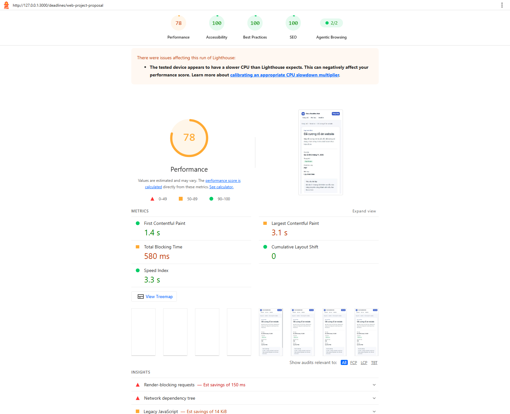
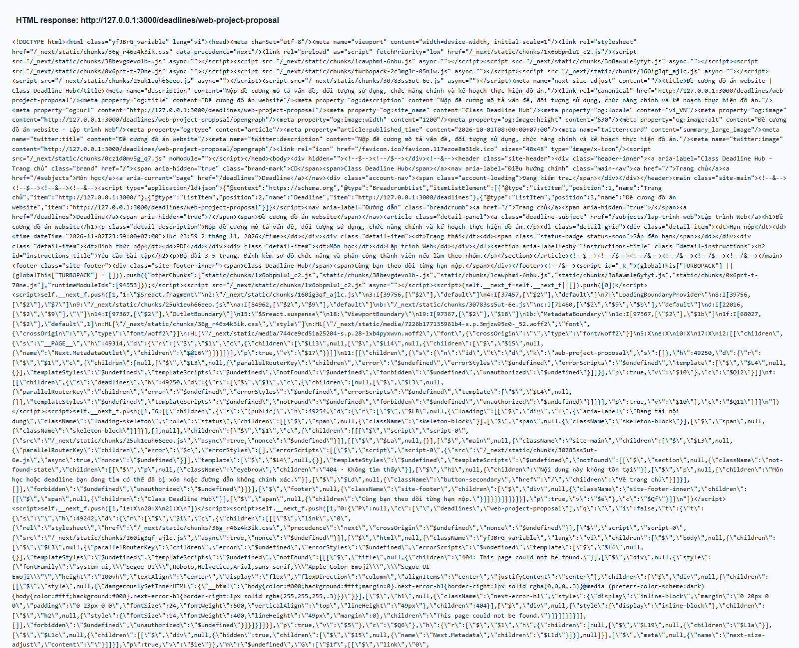

# Class Deadline Hub

Ứng dụng quản lý môn học và hạn nộp bài tập, xây dựng bằng Next.js App Router.
Deadline và tiến độ được lưu trong các tệp JSON phía server; Authentication dùng
NextAuth.js v4 Credentials Provider với JWT.

## Công nghệ

- Next.js 16.4.3, React 19 và TypeScript.
- App Router, Server Components mặc định, Server Actions cho thao tác dữ liệu.
- Noto Sans với subset tiếng Việt qua `next/font`; font được tự host cùng ứng dụng.
- JSON phía server tại `data/`, không sử dụng database.
- NextAuth.js 4.24.15, Zod, Jest và React Testing Library.

## Yêu cầu và cài đặt

Cần Node.js 20.9 trở lên và npm. Cài dependency:

```bash
npm install
```

Tạo `.env.local` ở thư mục gốc và đặt secret riêng (không commit tệp này):

```env
NEXTAUTH_SECRET=<secret ngẫu nhiên tối thiểu 32 bytes>
NEXTAUTH_URL=http://localhost:3000
SITE_URL=http://localhost:3000
```

Tạo secret bằng:

```bash
node -e "console.log(require('node:crypto').randomBytes(32).toString('base64'))"
```

`SITE_URL` phải là origin public chính xác khi triển khai, ví dụ
`https://deadline.example.edu.vn`. Nếu không đặt, ứng dụng dùng `NEXTAUTH_URL`
rồi mới fallback về `http://localhost:3000`; hãy thiết lập biến này trước khi
build production để metadata và sitemap dùng đúng host.

## Chạy ứng dụng

Development:

```bash
npm run dev
```

Kiểm tra và build production:

```bash
npm run lint
npm run typecheck
npm test
npm run build
```

Sau khi build thành công, chạy bản production trong một terminal:

```bash
npm run start
```

Mặc định mở `http://localhost:3000`.

## Tài khoản mẫu

| Tài khoản | Mật khẩu | Vai trò |
|---|---|---|
| `admin@ptit.edu.vn` | `admin123` | Admin |
| `sv@ptit.edu.vn` | `sv123456` | Sinh viên |

Đây là thông tin demo cố định cho bài tập, không dùng trong môi trường production.

## Cấu trúc chính

```text
data/
  subjects.json
  deadlines.json
  progress.json
src/
  app/
    (public)/
    (app)/
    sitemap.ts
    robots.ts
  components/
  lib/
  types/
tests/
screenshots/
```

- `data/subjects.json`: bốn môn học mẫu.
- `data/deadlines.json`: deadline mẫu, chứa `subjectId`, nội dung, hạn nộp và thời
  điểm tạo.
- `data/progress.json`: tiến độ độc lập theo `userId` và `deadlineId`.
- `src/lib/data.ts`: chỉ chạy ở server, kiểm tra cấu trúc JSON và thao tác file.
  Thao tác ghi được tuần tự hóa trong tiến trình hiện tại và thay tệp nguyên tử.
- `src/lib/permissions.ts`: ma trận quyền tập trung; Server Actions tự xác minh
  session và role trước khi ghi dữ liệu.

Khóa ghi JSON chỉ đồng bộ trong một tiến trình Node.js. Không chạy nhiều instance
cùng ghi chung các tệp; triển khai thực tế nên dùng kho dữ liệu có transaction và
lưu trữ dùng chung.

## Route và rendering

Route Group `(public)` và `(app)` không xuất hiện trong URL.

| URL | Quyền | Rendering / cache |
|---|---|---|
| `/` | Công khai | SSG; dữ liệu được cache dài hạn và làm mới khi admin thay đổi deadline. |
| `/subjects/[slug]` | Công khai | Subject có sẵn được prerender SSG; slug không tồn tại trả 404. |
| `/deadlines` | Công khai | ISR theo Cache Components, cache dữ liệu 60 giây. |
| `/deadlines/[id]` | Công khai | ISR 60 giây; admin thêm/xóa deadline gọi `revalidateTag()` và `revalidatePath()` để cập nhật ngay. |
| `/login` | Công khai | Trang đăng nhập, `noindex`. |
| `/dashboard` | Đã đăng nhập | SSR theo request; không cache tiến độ cá nhân; `noindex`. |
| `/admin` | Chỉ admin | SSR theo request; xác minh quyền ở trang và từng Server Action; `noindex`. |
| `/403` | Công khai | Trang không đủ quyền. |
| `/sitemap.xml` | Công khai | Sinh từ danh sách môn học và deadline hiện có. |
| `/robots.txt` | Công khai | Chặn crawler tại `/dashboard` và `/admin`. |
| `/opengraph-image` | Công khai | Ảnh chia sẻ chung cho website. |
| `/deadlines/[id]/opengraph` | Công khai | Ảnh chia sẻ sinh từ deadline tương ứng. |

### Vì sao trang chi tiết deadline dùng ISR?

Deadline có thể được admin thêm hoặc xóa sau khi deploy. ISR giúp trang có thể
được tái tạo định kỳ, trong khi invalidation theo tag/path làm mới các trang và
sitemap ngay sau thao tác quản trị. Cấu hình Cache Components của Next.js 16 dùng
`cacheLife()`/`cacheTag()`; không dùng `export const revalidate` của cấu hình cũ.
Deadline ID không tồn tại hiển thị giao diện `not-found.tsx`. Với Partial
Prerendering/streaming, Next.js có thể đã gửi HTTP 200 trước khi phần not-found
được render; đã xác nhận trường hợp này với `/deadlines/1`. Đây là giới hạn status
code của response đã stream, không phải lộ dữ liệu hay trả nội dung deadline sai.

### Vì sao Middleware/Proxy không đủ để bảo vệ `/admin`?

Proxy chỉ là lớp chặn sớm cho request đến trang. Nó không thay thế kiểm tra quyền
phía server cho thao tác dữ liệu: Server Actions có thể được gọi trực tiếp. Vì
vậy trang admin và từng action đều xác minh session, role và permission trước khi
đọc/ghi tệp. `robots.txt` cũng không phải cơ chế bảo mật; dữ liệu vẫn được bảo vệ
bằng kiểm tra server.

## Kiểm thử

```bash
npm test
npm run test:watch
```

Test bao gồm toàn bộ ma trận 12 tổ hợp role/action, đọc dữ liệu JSON và xử lý ID
không tồn tại, kiểm tra schema ngày/field, URL callback an toàn, serialize JSON-LD
chống thoát khỏi thẻ `<script>`, từ chối gọi trực tiếp Server Action trái quyền
và tương tác nút hoàn thành. Test cũng xác minh invalidation route deadline và
sitemap.

## Lighthouse và view-source

Đo trên bản production để kết quả không bị ảnh hưởng bởi development mode:

1. Chạy `npm run build`, sau đó `npm run start`.
2. Với Chrome đã cài, chạy Lighthouse cho trang chủ và một ID thật trong
   `data/deadlines.json` (ví dụ `web-project-proposal`):

   ```bash
   npx lighthouse http://localhost:3000/ --view
   npx lighthouse http://localhost:3000/deadlines/web-project-proposal --view
   ```

3. Mở `view-source:http://localhost:3000/deadlines/web-project-proposal` để kiểm
   tra HTML ban đầu, metadata và JSON-LD. ID `1` không có trong dữ liệu mẫu; hãy
   dùng ID hợp lệ thay vì `/deadlines/1`.

Lighthouse CLI 13.5.0 đã chạy trên production local bằng Chrome. Cả hai lần đo có
cảnh báo CPU trên máy kiểm thử chậm hơn mức Lighthouse kỳ vọng; điểm hiệu năng có
thể thay đổi theo máy và tải hệ thống:

| Trang | Performance | Accessibility | Best Practices | SEO |
|---|---:|---:|---:|---:|
| `/` | 68 | 100 | 100 | 100 |
| `/deadlines/web-project-proposal` | 78 | 100 | 100 | 100 |

Đã xử lý màu chữ tương phản thấp được Lighthouse phát hiện trong lần đo đầu. Ảnh
bên dưới được chụp từ log build thực tế, báo cáo Lighthouse thực tế và HTML response
thực tế của trang chi tiết. Báo cáo HTML/JSON đầy đủ cũng được lưu trong
[`screenshots/`](./screenshots/). Ảnh view-source dùng ID có thật vì `/deadlines/1`
không tồn tại.

### Kết quả `npm run build`



### Lighthouse trang chủ



[Báo cáo HTML](./screenshots/lighthouse-home.report.html) ·
[Dữ liệu JSON](./screenshots/lighthouse-home.report.json)

### Lighthouse trang chi tiết deadline



[Báo cáo HTML](./screenshots/lighthouse-deadline.report.html) ·
[Dữ liệu JSON](./screenshots/lighthouse-deadline.report.json)

### HTML nguồn của trang deadline



Ảnh source hiển thị nội dung HTML nhận được từ
`/deadlines/web-project-proposal`, gồm metadata Open Graph, BreadcrumbList JSON-LD
và nội dung trang được server render.

Các điểm Lighthouse chỉ phản ánh lần chạy trên môi trường local, không bảo đảm
thứ hạng tìm kiếm hoặc việc Google lập chỉ mục.
